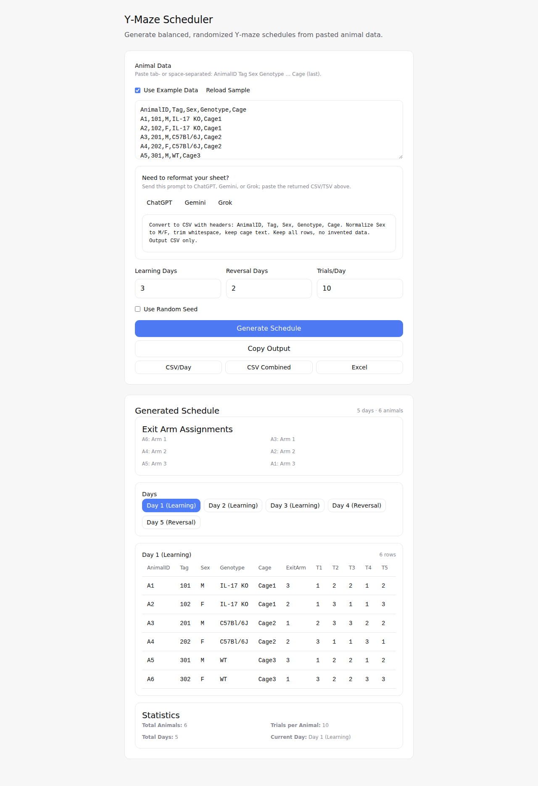

# Y-maze Randomizer

Modern React + FastAPI app with lab notebook neo-brutalist styling under `modern-app/`. Legacy Tkinter GUI is documented separately in `LEGACY.md`.

Part of **Easylab Suite**: when bundled, it launches from the suite desktop launcher as the **Y-Maze Randomizer** module.

## Features (shared logic)
- Uses the named **Standard learning and reversal** protocol with editable local copies. Balance groups can use genotype, sex and cage; locked learning exit arms are retained.
- Records an explicit seed for every schedule, including automatic seeds. Set the maximum permitted consecutive starts on the same arm.
- Reviews learning exit-arm totals, subgroup counts and each day's schedule before locking the run for export.
- Saves the exact reviewed schedule, animal input, protocol, seed and locks in local storage and a portable JSON package.
- Exports the reviewed day tables to per-day CSV, combined CSV or an Excel workbook with protocol settings. Excel exports the displayed schedule without generating it again.
- Paste or type animal data directly; input rows use `AnimalID Tag Sex Genotype Cage`.

## Modern web app (preferred)
- See `modern-app/README.md` for setup and dev commands.
- Example run (Playwright E2E with bundled data — refreshed Dec 28, 2025): 
- EasyLab Next uses strict local API port 18523 and browser preview port 19523. The standalone preview requires the dedicated Next Python environment and runtime paths described in `modern-app/README.md`.

## Legacy Tkinter GUI (archived)
- Requirements: Python 3 with Tkinter (bundled in most installs); `openpyxl` for Excel export (`pip install openpyxl`).
- Run:
  ```bash
  python code.py
  ```
- Enter animal rows in the text box (`AnimalID Tag Sex Genotype Cage`), set learning/reversal days and trials, then click **Generate**. Copy output or export CSV/Excel as needed.

## Example Input

An example input sheet is available at [`examples/example_input.csv`](examples/example_input.csv),
which demonstrates the expected column layout:

```
AnimalID,Tag,Sex,Genotype,Cage
A1,101,M,IL-17 KO,Cage1
A2,102,F,IL-17 KO,Cage1
A3,201,M,C57Bl/6J,Cage2
A4,202,F,C57Bl/6J,Cage2
```

For illustration, a generated day-1 schedule for these animals might look like:

```
AnimalID,Day1ExitArm
A1,1
A2,2
A3,3
A4,1
```

Actual schedules may vary depending on the random seed and parameter choices.

## Notes
- Exit arm assignments are deterministic for a given random seed; leave the seed blank for a fresh randomization each run.
- Excel export requires `openpyxl`; a warning is shown if the library is missing.

## Contributing
Pull requests are welcome! Please open an issue to discuss major changes before submitting.

## License
Copyright (c) 2026 Meghamsh Teja Konda. All Rights Reserved. See `LICENSE`.

## Contact
Project maintainer — meghamshteja555@gmail.com
