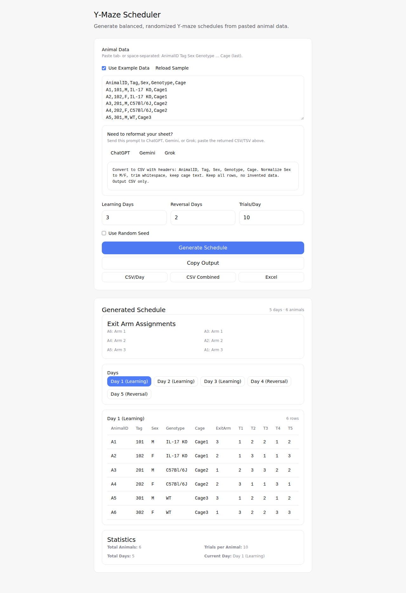

# Y-Maze Randomizer (React + FastAPI)

The guided Y-maze workflow imports animals, applies a named protocol, generates a seeded schedule, and requires review before export. It shows learning exit-arm counts and subgroup balance, supports locked learning assignments, and saves a portable package containing the exact reviewed day tables and settings.

Part of **Easylab Suite**: this repo is bundled as the **Y-Maze Randomizer** module (`ymaze`).

License: All Rights Reserved. See `../LICENSE`.

## Project structure
- `src/` – React UI (Vite + TypeScript + Tailwind).
- `backend/` – FastAPI API with scheduling logic.
- `example_data/animals.csv` – Built-in dataset for example mode.
- `tests/` – Python schedule/export regressions and Playwright workflow checks.
- `screenshots/example_run.png` – Historical screenshot from the earlier interface.

## Screenshot
| Example run (Use Example Data) |
| --- |
|  |

## Runtime and ports

EasyLab Next uses the `codex/easylab-next-20261113` worktree. Its Suite API uses strict loopback port **18523**. The isolated browser preview uses strict port **19523**. Preview data, settings, exports, Python cache and user data are rooted under `runtime/ymaze` inside the EasyLab Next runtime. The Suite supplies its own Next Electron user profile.

## Setup
```bash
npm ci
python3.11 -m venv '/Volumes/Coding Projects/Active/easylab-next/runtime/python-envs/ymaze'
'/Volumes/Coding Projects/Active/easylab-next/runtime/python-envs/ymaze/bin/python' -m pip install -r backend/requirements.txt
```

## Run an isolated preview

Set `EASYLAB_PYTHON` to the interpreter in that dedicated environment. From this directory, run:

```bash
# Point the backend at the dedicated runtime environment.
export EASYLAB_PYTHON='/Volumes/Coding Projects/Active/easylab-next/runtime/python-envs/ymaze/bin/python'
# API on 127.0.0.1:18523
npm run dev:back
# Browser UI on 127.0.0.1:19523
npm run dev:front
```
The API launcher refuses to start from another checkout or when port 18523 is occupied. Vite refuses to use a different port if 19523 is occupied. Open `http://127.0.0.1:19523` and choose **Use Example Data** for a fictional walkthrough.

## Data format & quick AI helper
- Required columns (CSV/XLSX): `AnimalID, Tag, Sex, Genotype, Cage` (see `example_data/animals.csv`).
- Need to reshape first? Use: [ChatGPT](https://chat.openai.com/), [Gemini](https://gemini.google.com/app), [Grok](https://grok.com/).
- Prompt: "Convert my table to CSV with headers: AnimalID, Tag, Sex, Genotype, Cage. Keep data unchanged, no new rows, output UTF-8 CSV text only."
- Save as `animals.csv`, then upload or paste. See `screenshots/data-format-helper.svg` for a one-screen guide.

## Checks
```bash
python -m unittest discover -s tests -p 'test_*.py'
npm run test:e2e
```
Playwright starts both strict-port servers in an isolated browser context. Python tests check same-seed replay, automatically generated seed replay, hard locks, repeat limits, exact Excel table cells and literal text cells for formula-like values.

## Spreadsheet text safety

Excel workbook exports keep animal and protocol text as literal cells, including strings that begin with `=`, `+`, `-` or `@`. CSV has no cell types, so it keeps the exact values and the app advises importing affected columns as text in spreadsheet software.

## API highlights
- `POST /generate-schedule` – returns a schedule, effective seed, protocol settings, input animals and locks.
- `POST /export-reviewed-excel` – exports the exact submitted day tables with a protocol summary sheet.
- `POST /export-excel` – preserves the earlier request-and-generate route for legacy callers.
- `POST /upload`
- `GET /health`

All endpoints honor `use_example: true` to operate on `example_data/animals.csv`, so the app runs even without user-provided data.
